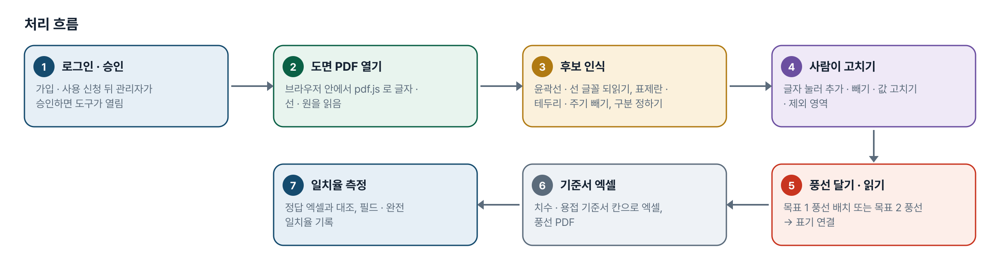
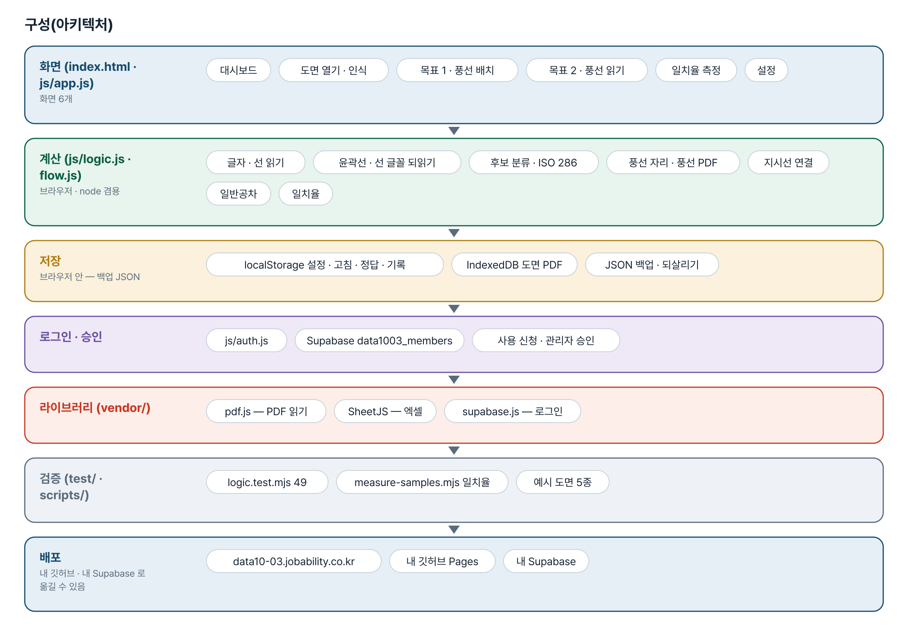
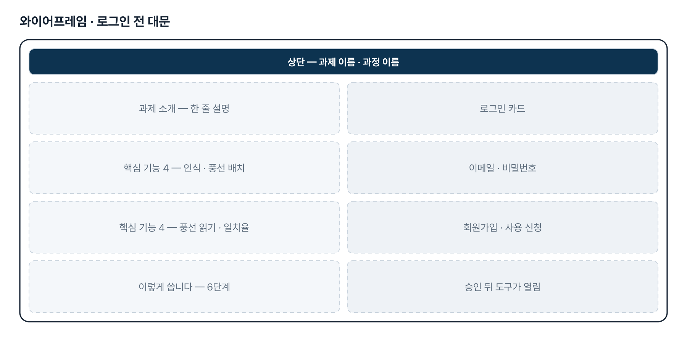
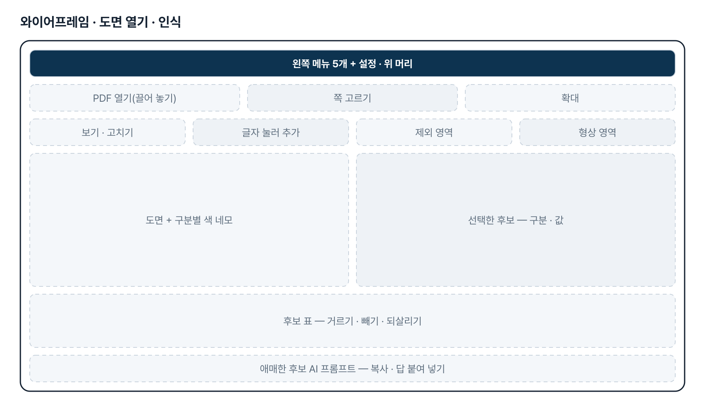
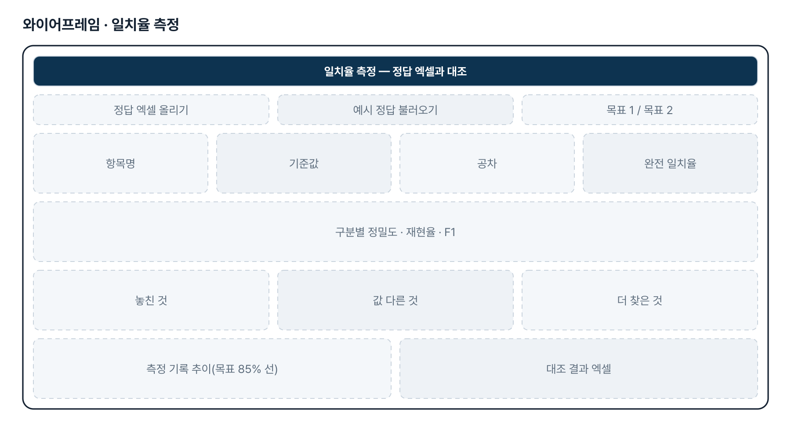
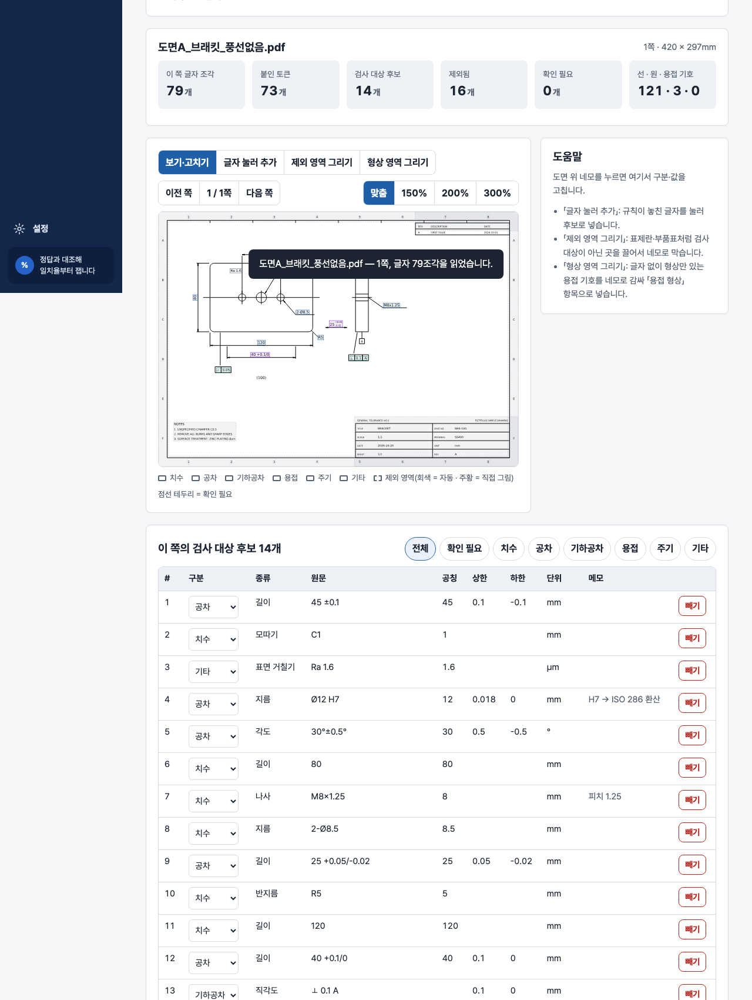

# 검사 기준서 작성 자동화 — 프로젝트 기획서 v2.0

- 기획: 황수용 · 작성일 2026-11-10 · 현장 데이터 디지털화 전문가과정 · 2차수 프로젝트 03
- 바로 쓰기: https://data10-03.jobability.co.kr/
- 워드 판: `docs/기획서/data10-03_황수용_검사기준서작성자동화_기획서_v2.0.docx`

## 개요

PDF 도면의 치수 · 공차 · 기하공차 · 용접 표기를 읽어 번호 풍선을 달거나 풍선별 정보를 기준서 양식 엑셀로 뽑고, 정답과 대조해 인식 일치율을 재는 도구입니다.

### 배경 · 현재 업무
- 도면을 보고 검사 기준서를 만들 때 검사 대상 표기마다 번호 풍선을 달고, 풍선 번호별 Spec · 공차를 엑셀에 옮겨 적습니다.
- 자동화 프로젝트가 진행되어 있지만 인식 일치율이 낮아 최소 85% 까지 올리려 합니다.
- 일치율은 필드 일치율(항목명 · 기준값 · 공차)과 완전 일치율 두 가지 식으로 셉니다.
- 도면은 벡터 PDF 지만 글자가 칠한 윤곽선이나 한 줄 선 글꼴로 들어 있는 경우가 있고, 기준서는 치수 · 용접 두 가지로 나뉩니다.
- 자주 틀리는 것은 용접 기호 · 각장 Spec 과 부기(주기 · 노트)입니다.

### 목표
- 목표 1 — 풍선이 없는 도면에서 검사 대상을 찾아 번호 풍선을 단 PDF 를 냅니다.
- 목표 2 — 풍선이 있는 도면에서 풍선마다 치수 · 공차 · 용접 정보를 이어 엑셀로 냅니다.
- 정답과 같은 식으로 대조해 인식 일치율 85% 이상을 숫자로 확인합니다.
- 엑셀을 사람이 쓰는 기준서와 같은 칸(No. · Inspection Item · Standard · Tolerance MAX/MIN)으로 냅니다.

## 요구사항과 구현

| 기획서 요구 | 구현 |
|---|---|
| 목표 1 · 번호 풍선 자동 배치 → 풍선 포함 PDF | 후보 인식 → 번호 순서(줄 · 열 · 구역) → 겹치지 않는 자리 → 풍선 PDF · 엑셀. 원본 벡터를 그대로 두는 편집은 2단계 |
| 목표 2 · 풍선별 정보 엑셀 | 원 안 숫자 = 풍선, 지시선 끝 · 가까운 글자 연결, 치수 · 공차 · 기하공차 · 용접 |
| 형상만 있는 용접은 도형으로 | 용접 형상 그림(미리보기 · 그림 받기)과 엑셀에 잘라낼 영역 좌표 |
| 인식 일치율 85% 이상 | 필드 · 완전 일치율 측정. 새 도면 2종 목표 2 완전 일치율 45.5% → 97.2%(같은 도면으로 고치고 잰 숫자) |
| 치수 기준서 / 용접 기준서 구분(2차) | 기준서 구분(전체 · 치수 · 용접)별 번호 · 풍선 PDF · 엑셀 |
| 용접 기호 · 각장 · 부기(2차) | ISO 2553 기준선 찾기, 기준선 위 크기 글자, 단속, 용접 부기 |
| 「2x」 = 실측값 2개(3차) | 기준서 엑셀에 측정값 칸을 개수만큼 비워 둠 |
| 회색 · 파란 한 줄 선 글꼴(3차) | 선 토막을 글자로 묶어 직접 그린 선 글자표와 모양 맞추기 |
| 스캔 도면 | 2단계 — 글자가 없으면 알려 주고 멈춤(OCR 없음) |

## 주요 기능

- **도면 열기 · 인식** — 벡터 PDF 의 글자 · 윤곽선 글자 · 선 글꼴을 읽어 치수 · 공차 · 용접 후보를 도면 위에 표시합니다.
- **목표 1 · 풍선 배치** — 후보에 번호 풍선을 겹치지 않게 달고 풍선 PDF · PNG · 기준서 엑셀을 냅니다.
- **목표 2 · 풍선 읽기** — 풍선 번호를 지시선 끝의 표기와 이어 풍선별 Spec · 공차를 기준서 엑셀로 뽑습니다.
- **일치율 측정** — 정답 엑셀과 대조해 필드 · 완전 일치율, 놓친 것 · 값 다른 것을 보이고 기록합니다.
- **치수 · 용접 기준서 구분** — 기준서를 치수 · 용접으로 나눠 번호 · 풍선 PDF · 엑셀을 따로 냅니다.
- **일반공차** — 도면 주기의 ISO 13920 · 2768 을 찾아 공차 없는 치수의 MAX · MIN 을 채웁니다.
- **AI 확인** — 애매한 후보의 글자와 주변 글자만 담은 프롬프트를 만들고 답을 반영합니다.
- **로그인 · 사용 승인** — 회사 메일이나 개인 메일로 가입하고 사용 신청 → 관리자 승인 뒤 씁니다.

## 처리 흐름(파이프라인)

1. **로그인 · 승인** — 가입 · 사용 신청 뒤 관리자가 승인하면 도구가 열림
2. **도면 PDF 열기** — 브라우저 안에서 pdf.js 로 글자 · 선 · 원을 읽음
3. **후보 인식** — 윤곽선 · 선 글꼴 되읽기, 표제란 · 테두리 · 주기 빼기, 구분 정하기
4. **사람이 고치기** — 글자 눌러 추가 · 빼기 · 값 고치기 · 제외 영역
5. **풍선 달기 · 읽기** — 목표 1 풍선 배치 또는 목표 2 풍선 → 표기 연결
6. **기준서 엑셀** — 치수 · 용접 기준서 칸으로 엑셀, 풍선 PDF
7. **일치율 측정** — 정답 엑셀과 대조, 필드 · 완전 일치율 기록

## 구성(아키텍처)

- **화면 (index.html · js/app.js)** — 대시보드 · 도면 열기 · 인식 · 목표 1 · 풍선 배치 · 목표 2 · 풍선 읽기 · 일치율 측정 · 설정
- **계산 (js/logic.js · flow.js)** — 글자 · 선 읽기 · 윤곽선 · 선 글꼴 되읽기 · 후보 분류 · ISO 286 · 풍선 자리 · 풍선 PDF · 지시선 연결 · 일반공차 · 일치율
- **저장** — localStorage 설정 · 고침 · 정답 · 기록 · IndexedDB 도면 PDF · JSON 백업 · 되살리기
- **로그인 · 승인** — js/auth.js · Supabase data1003_members · 사용 신청 · 관리자 승인
- **라이브러리 (vendor/)** — pdf.js — PDF 읽기 · SheetJS — 엑셀 · supabase.js — 로그인
- **검증 (test/ · scripts/)** — logic.test.mjs 49 · measure-samples.mjs 일치율 · 예시 도면 5종
- **배포** — data10-03.jobability.co.kr · 내 깃허브 Pages · 내 Supabase

## 화면 구성(와이어프레임)

## 규칙 · 판정 기준

- 필드 일치율 = 그 필드가 맞은 건수 ÷ 정답 행 수 × 100, 완전 일치율 = 항목명 · 기준값 · 공차가 모두 맞은 행 ÷ 정답 행 수 × 100(못 찾은 행은 불일치).
- 목표 2 는 풍선 번호로, 목표 1 은 값(구분 · 공칭 · 상하한)으로 정답과 짝을 짓습니다.
- 표제란 · 개정란 · 테두리 띠 · 주기 · 참고 치수는 검사 대상에서 뺍니다(설정에서 조정).
- 공차가 없는 치수는 도면 주기의 일반공차(ISO 13920 · 2768) 표로 MAX · MIN 을 채웁니다.
- 끼워맞춤 공차는 ISO 286 의 자주 쓰는 등급만 환산하고, 그 밖은 「확인 필요」로 남깁니다.
- 「2x」 는 같은 Spec 을 두 곳 잰다는 뜻으로, 측정값 칸을 개수만큼 비워 둡니다.

## 검증

- 계산 규칙 테스트 49개 통과
- 예시 도면 5종을 pdf.js 로 실제로 읽는 전체 흐름이 시험에 들어 있습니다(예시 138개 중 136개, 98.6%).
- 고친 규칙을 하나씩 끄거나 바꿔 시험이 실패하는지 확인했습니다.
- 실제 도면 숫자는 같은 도면을 보며 고치고 잰 것이라, 새 도면에서는 먼저 다시 잽니다.

## 이번 판에서 하지 않는 것

- 업무 자료(도면 · 정답 · 측정 기록)는 아직 팀 공유 DB 가 아니라 각자의 브라우저에 저장합니다.
- 스캔 그림 도면은 읽지 못합니다(OCR 없음).
- 풍선 PDF 는 원본 쪽을 그림으로 넣고 풍선만 벡터입니다. 원본 벡터를 그대로 두는 편집은 하지 않습니다.
- 규칙 기반이라 회사 도면 양식 · 글꼴이 다르면 맞춰야 합니다. 실제 도면 일치율은 다음 도면에서 다시 낮을 수 있습니다.
- 남은 틀림 — 용접 형상 연결 · No Weld · PCD 등은 아직 고치지 않았습니다.

## 다음 단계

- 팀 공유 저장 — 도면별 고침 · 정답 · 측정 기록을 Supabase 에 두고 승인된 팀원이 함께 보기
- 또 다른 새 도면으로 고치기 전에 먼저 재기
- 남은 용접 형상 연결 · No Weld · PCD · 공차 확인 항목 보정
- 스캔 도면 OCR, 원본 벡터를 유지한 풍선 PDF

## 버전 이력

- **v2.0** (2026-11-10) — 최종 기획서 — 파이프라인 · 아키텍처 · 와이어프레임 정리 / 로그인 · 사용 신청 · 관리자 승인(요청자 Supabase 로 옮길 수 있게) / 로그인 전 대문
- **v1.3** (2026-10-27) — 판 맞추기 — css · js 판 질의 ?v= · fresh-guard · 판 확인 시험
- **v1.2** (2026-10-21) — 3차 — 새 도면 2종 먼저 측정(완전 일치율 45.5% → 97.2%) / 수강생 기준서 양식 엑셀 · 2x 측정값 칸 / 한 줄 선 글꼴 · 일반공차
- **v1.1** (2026-10-21) — 2차 — 실제 도면 2장 측정(완전 일치율 3.0% → 90.5%) / 윤곽선 글자 읽기 · 용접 기준선 · 치수/용접 기준서 구분
- **v1.0** (2026-10-20) — 1단계 — 도면 번호 풍선 · 풍선별 정보 엑셀 · 일치율 측정
